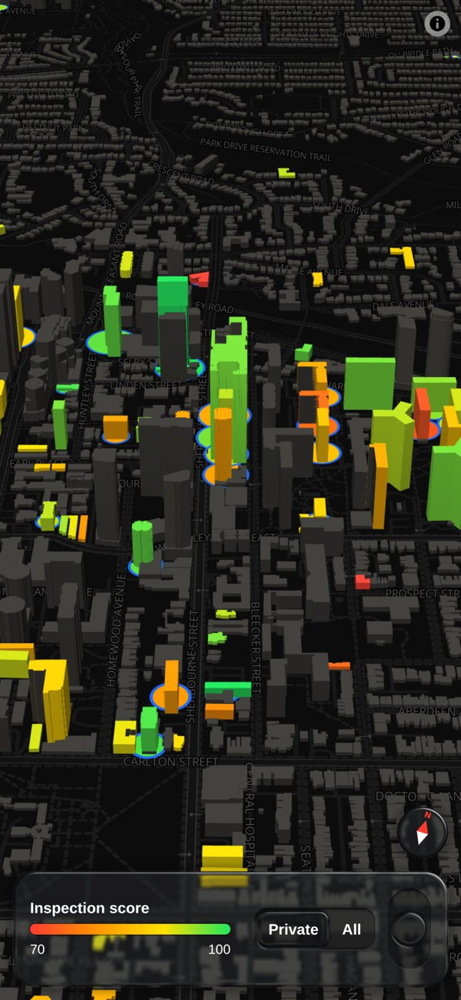

# Toronto apartments: every registered rental building, and what is available today

By [Blair Zasitko](https://blairz.ca)

**Open it: https://blairz.ca/apartments/**

Buildings are the inventory; listings are what is available in them. The inventory is the
City of Toronto's apartment building registry: every rental building of three or more storeys
and ten or more units. Each one is drawn in 3D, sized by its number of units and coloured by
its city inspection score. Availability comes from the landlords' own websites and is attached
to a registry building, or dropped and counted. A listing is never shown as a loose point.

The number this project exists to print is **coverage**: the share of private registry units
in a building for which there is a working availability source.

## Layout

| Path | What |
|---|---|
| `data/registry/` | The city's open data as downloaded |
| `build/` | Registry to `app/data/buildings.json` |
| `collect/` | One adapter per landlord platform, address matching, state and the coverage report |
| `collect/sources/` | Which landlord runs which site on which platform |
| `app/` | The static map. No backend at run time |
| `tests/` | `pytest tests/` and `node --test tests/js/*.test.mjs`, on invented data and saved fixtures |

## How it works

- Matching a listing to a building is by normalised address, then by distance, with a limit;
  anything that does not match is counted, not guessed.
- Collection is polite: one request at a time per site, with each site's failures recorded
  so a broken adapter shows up in the coverage number instead of as silence.
- The map draws at no more than 2 device pixels per CSS pixel with multisampling, and loads
  fully behind a plain screen before it shows.
- Controls are from [glass-ui-kit](https://github.com/datumsOG/glass-ui-kit).

## How it was made

I designed this and directed its construction with AI coding agents (Claude Code): I wrote the
specification, made the design decisions and tested the result.

## Data and credits

- Buildings and inspection scores: [Apartment Building Registration](https://open.toronto.ca/dataset/apartment-building-registration/)
  and [Apartment Building Evaluation](https://open.toronto.ca/dataset/apartment-building-evaluation/),
  City of Toronto Open Data, under the [Open Government Licence – Toronto](https://open.toronto.ca/open-data-license/).
- Map: [OpenFreeMap](https://openfreemap.org/), © [OpenStreetMap](https://www.openstreetmap.org/copyright) contributors.

The code is MIT-licensed (see `LICENSE`). The data stays under its own licence.
